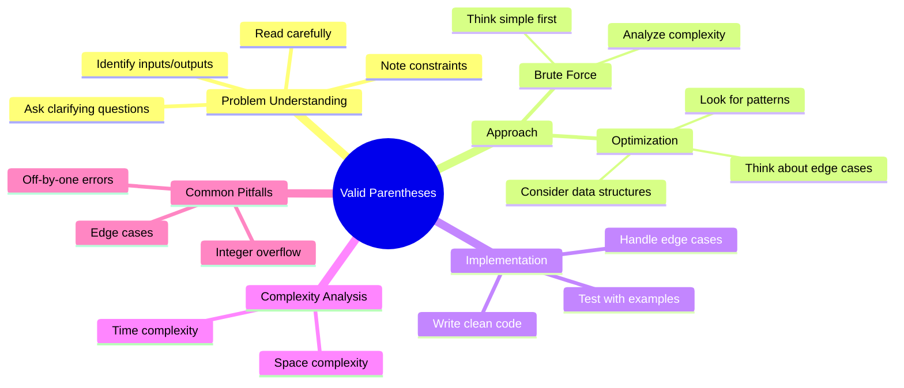

# Valid Parentheses

**Problem Link:** [Valid Parentheses](https://leetcode.com/problems/valid-parentheses/description)

**Category:** Google tagged

## Problem-Solving Mindmap

## Key Insights

- **Pattern Recognition**: Identify the problem type (array, string, tree, graph, DP, etc.)
- **Data Structure Choice**: Choose the right data structure for optimal solution
- **Algorithm Strategy**: Greedy, two-pointers, sliding window, DFS/BFS, dynamic programming, etc.

## Things to Remember

*Add your notes after solving the problem*

## Template Approach

1. **Understand**: Read the problem and examples
2. **Plan**: Choose approach and data structures  
3. **Code**: Implement solution
4. **Test**: Verify with test cases
5. **Optimize**: Improve time/space complexity if needed

---

*This mindmap was auto-generated. Update it with problem-specific insights after solving.*
